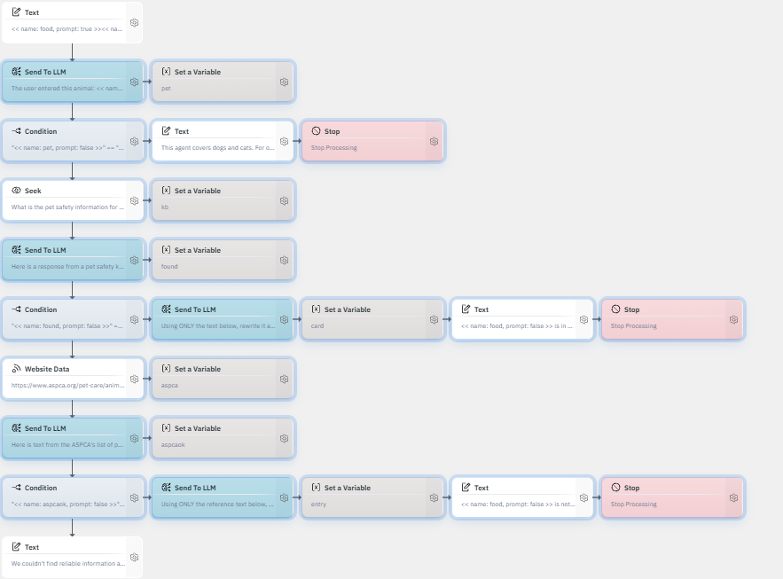

# SafePaw — a Pet Safety AI Agent

SafePaw is an AI agent built on NeuralSeek's mAIstro that answers one question pet owners ask all the time: *"Is this safe for my dog or cat?"* You give it a food, plant, medication, or household item and your pet, and it tells you how dangerous the item is, what symptoms to watch for, and what to do next.

This document walks through SafePaw's exported flow node by node: how it searches a curated knowledge base first, falls back to a trusted outside source when it has to, and refuses to guess when neither source has the answer.

## Why SafePaw Exists

When a pet eats something it shouldn't, owners usually turn to a quick web search or a general-purpose chatbot. Search results are scattered and inconsistent, and a chatbot will confidently answer from memory, even when that memory is wrong. For pet safety, a wrong answer isn't a small mistake. Calling a toxic plant "mild," or suggesting a home remedy, can cost an animal its life.

SafePaw was built to give fast, consistent answers that come only from sources it has actually checked, and to say plainly when it doesn't know.

## The Core Design Problem: Avoiding Hallucinated Safety Advice

Early versions of SafePaw showed the problem clearly. When an item wasn't in the knowledge base, the LLM filled the gap with its own guesses. It rated avocado as highly toxic to dogs, called coffee grounds low-risk, and once recommended inducing vomiting. The final design separates *deciding whether a source has the answer* from *writing the answer*, using four phases:

1. **Scope:** Confirm the pet is a dog or cat, the animals SafePaw's sources actually cover. Anything else is referred to an exotic-animal vet.
2. **Retrieve:** Search the curated knowledge base with Seek. If that fails, scrape the ASPCA's People Foods list.
3. **Verify:** Before writing anything, a separate LLM call answers a strict YES/NO question: does this source actually cover the item?
4. **Answer:** Only if verification passes does an LLM write the entry, using only the retrieved text. Missing details are marked "Not specified" rather than invented.

If no source passes verification, SafePaw says it couldn't find reliable information and points the user to their vet or the ASPCA Animal Poison Control Center.

## Architecture

[](Serrano_SafePaw_Flow.png)

## Node-by-Node Breakdown

### 1. Text — User Input

Collects the two inputs from the user using prompt variables.

**Prompt:** `<< name: food, prompt: true >><< name: animal, prompt: true >>`

**Output →** Variables `food` and `animal`

### 2. Send to LLM — Normalize the Animal

Users type pets in many ways ("Dog," "puppy," "kitten"). This node reduces the input to a single value the rest of the flow can rely on.

**Prompt:** Classify the animal as `dog`, `cat`, or `other`, in lowercase with no punctuation.

**Parameters:** `cache: false`

**Output →** `Set a Variable: pet`

### 3. Condition — Scope Check

If `pet` is `other`, SafePaw stops and refers the user to an exotic-animal vet or the ASPCA Animal Poison Control Center.

**Condition:** `"<< name: pet >>" == "other"`

**Output →** `Text` (scope message) → `Stop`

### 4. Seek — Knowledge Base Lookup

Runs a RAG query against SafePaw's curated knowledge base of 62 entries covering foods, plants, medications, and household items. The query uses only the item, not the animal, so Seek returns the full entry instead of an answer narrowed to one species.

**Query:** `What is the pet safety information for << name: food >>?`

**Output →** `Set a Variable: kb`

### 5. Send to LLM — Was It Found?

Seek words its "not found" responses differently every time, so the flow can't simply match a phrase. This node reads Seek's answer and returns a single word.

**Prompt:** Reply `NO` if the response says the knowledge base has no information about the item, even if it then adds general knowledge. Otherwise, if it gives safety information about the item or a main ingredient (for example, chocolate in chocolate chip cookies), reply `YES`.

**Parameters:** `cache: false`

**Output →** `Set a Variable: found`

### 6. Condition — Found in Knowledge Base

**Condition:** `"<< name: found >>" == "YES"`

**Output →** Nodes 7 and 8, then `Stop`

### 7. Send to LLM — Format the Entry

Rewrites Seek's paragraph into SafePaw's standard entry format, using only the text Seek returned. Fields the text doesn't cover are marked "Not specified." If the knowledge base doesn't cover the user's pet, the entry says so instead of guessing.

**Format:**
```
Item:
Category:
Pets affected:
Toxicity:
Toxic component:
Symptoms:
What to do:
```

**Parameters:** `cache: false`

**Output →** `Set a Variable: card`

### 8. Text — Display Database Result

Wraps the formatted entry with a header and the ASPCA Animal Poison Control Center number.

**Output →** `Stop`

### 9. Website Data — Scrape the ASPCA People Foods List

The fallback source for foods that aren't in the knowledge base.

**Parameters:** `url: https://www.aspca.org/pet-care/animal-poison-control/people-foods-avoid-feeding-your-pets`, `selectors: ['main']`

**Output →** `Set a Variable: aspca`

### 10. Send to LLM — Is It on the ASPCA Page?

The verification step for the fallback. Asking the writing LLM to also decide whether to write proved unreliable: it produced blank or invented entries for items the page never mentions. A separate YES/NO check fixed that.

**Prompt:** Does the text specifically mention the item or a main ingredient it contains? Reply `NO` if the text is empty, an error, or doesn't mention it.

**Parameters:** `cache: false`

**Output →** `Set a Variable: aspcaok`

### 11. Condition — Found on ASPCA Page

**Condition:** `"<< name: aspcaok >>" == "YES"`

**Output →** Nodes 12 and 13, then `Stop`

### 12. Send to LLM — Write the ASPCA Entry

Writes an entry in the standard format using only the scraped ASPCA text. General references to "pets" are treated as covering dogs and cats. The prompt forbids adding outside information and forbids recommending home treatment such as inducing vomiting.

**Parameters:** `cache: false`

**Output →** `Set a Variable: entry`

### 13. Text — Display ASPCA Result

Labels the answer as coming from the ASPCA's People Foods list and asks the user to verify it with their vet.

**Output →** `Stop`

### 14. Text — No Information Found

Reached only when neither source passes verification. SafePaw says it couldn't find reliable information, tells the user not to guess, and gives the ASPCA Animal Poison Control Center number.

## Model Used

| Component | Model |
|---|---|
| All Send to LLM nodes | `llama-3.1-8b-instruct` |

## Example Walkthrough

*"My cat got into the lilies. Is that dangerous?"*

1. The user enters **lilies** and **cat**. The animal check confirms the **pet** is a cat, so the request is in scope.
2. **Seek** searches the knowledge base and returns the lilies entry: highly toxic to cats, with all parts dangerous, including pollen and vase water.
3. The **found** check reads Seek's answer and returns `YES`.
4. The format step turns it into a **card**: highly toxic, with symptoms of vomiting, lethargy, loss of appetite, and kidney failure, and instructions to contact a vet immediately.
5. SafePaw displays the entry with the poison control number and stops. If the user had asked about *coconut* instead, which isn't in the knowledge base, SafePaw would have found it on the ASPCA page. For *hosta*, which neither source covers, it would have said it couldn't find reliable information rather than guess.

## Files in This Repo

- `Serrano_SafePaw.dat` — The exported mAIstro agent. Import it from **User Agents** in mAIstro.
- `Serrano_SafePaw_Dependencies.txt` — Setup requirements: the knowledge base upload and the ASPCA web connection.
- `pet_safety_kb.txt` — The curated knowledge base loaded into NeuralSeek (62 entries).
- `Serrano_SafePaw_Flow.png` — The flow diagram shown above.
- `README.md` — This document.